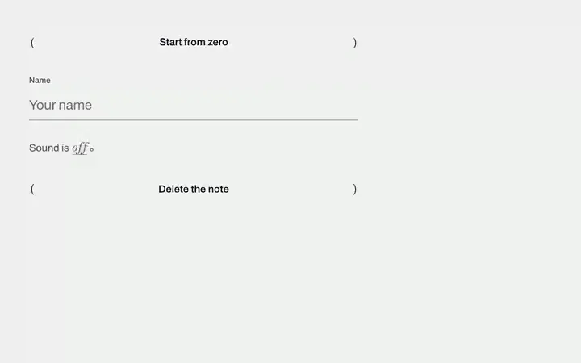

# PR #12463: fresh installation and review evidence

Captured 24 October 2026 for the [directory submission](https://github.com/shadcn-ui/ui/pull/12463). The proposed namespace is `@0nlytype`. The submission is **submitted, not accepted**. This evidence supports review; it is not a full-library release or an accessibility certification.

## Short demo



The recording shows a new Next.js app using four components downloaded from `https://thedirectors.agency/ui/r/{name}.json` with the shadcn CLI. Only the demo page was written after installation; the installed component source was not edited. The page uses the documented composition (`DialogContent`, `DialogTitle`, `DialogDescription`, `DialogActions`), the same as the library's own dialog example.

[Day screenshot](evidence/pr-12463/day.png) · [Nocturne screenshot](evidence/pr-12463/nocturne.png)

## Results

| Check | Result | Execution time |
| --- | --- | --- |
| Official `validate:registries` on PR head `244ff4415e22c23c0d733e3bcb4572b922098ccb` | Passed: directory schema, public payload, all entries included | 0.349 s |
| Fresh install with `shadcn@latest` (4.22.1), then `tsc --noEmit` and `next build` | Passed for button, field, switch and dialog with their dependencies | not timed |
| Demo app TypeScript check and production build, after the demo page was written | Passed | 5.56 s |
| Browser interaction recording | Played through in day and nocturne; no console errors or warnings | 15.1 s recording, including pauses |

Toolchain actually resolved: Node 22.22.0, shadcn 4.22.1, Next.js 16.4.3, React 19.3.0, TypeScript 5.9.3, Tailwind CSS 4.3.3.

The first demo page passed the build but used `DialogSurface`, the unstyled primitive, on its own, so the dialog opened without its frame. That was a mistake in the demo page, not in the library, and it was replaced by the documented composition before recording. No new test suite was written.

## The registry, live

| Endpoint | Result |
| --- | --- |
| `https://thedirectors.agency/ui` | 200, `text/html` |
| `https://thedirectors.agency/ui/r/registry.json` | 200, `application/json`; `name` is `0nlytype`, 848 items, no duplicate names |
| `https://thedirectors.agency/ui/r/button.json` | 200, `application/json` |
| `https://thedirectors.agency/ui/r/dialog.json` | 200, `application/json` |

## Reproduce the fresh installation

```sh
npx --yes create-next-app@latest fresh --ts --tailwind --eslint --app --src-dir --no-import-alias --use-npm --yes
cd fresh
npx --yes shadcn@latest init -d -y
for c in button field switch dialog; do npx --yes shadcn@latest add "https://thedirectors.agency/ui/r/$c.json"; done
npx tsc --noEmit && npx next build
```

`shadcn@latest` resolved to 4.22.1 on the day.

The namespace is still pending acceptance, so this evidence uses the public URLs rather than claiming `@0nlytype/button` resolves by default.
